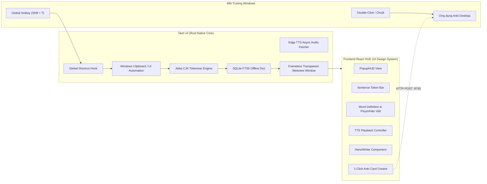

# ARCHITECTURE OVERVIEW: HANZII DICT DESKTOP

> **Tài liệu**: Tổng quan Kiến trúc Hệ thống, Ranh giới Mô-đun & Luồng Dữ liệu  
> **Chuẩn áp dụng**: `modular-architecture`, `ui-design-system`

---

## 1. MÔ HÌNH KIẾN TRÚC TỔNG THỂ

Hệ thống kết hợp giữa **Tauri v2 (Rust Backend)** và **React 18 / TypeScript / Tailwind CSS (Frontend HUD)**:

---

## 2. RANH GIỚI MÔ-ĐUN (`modular-architecture`)

Mọi tính năng nằm trong thư mục độc lập `src/modules/<feature>/` và chỉ tương tác qua `index.ts`:

1. `src/modules/core-infra/`:
   - Quản lý Atomic Components (`@/components/ui`), Theme Tokens, Root layout.
2. `src/modules/segmentation/`:
   - Xử lý thuật toán tách từ tiếng Trung, tìm kiếm ranh giới n-gram, chuẩn hóa chuỗi CJK.
3. `src/modules/dictionary/`:
   - Kết nối SQLite FTS5, tìm kiếm chính xác, tìm kiếm gần đúng, nạp dữ liệu định nghĩa và ví dụ.
4. `src/modules/popup-hud/`:
   - Điều khiển cửa sổ nổi (Always-on-top, auto-repositioning theo chuột, Esc to close, Ghim cửa sổ).
5. `src/modules/tts-audio/`:
   - Quản lý luồng âm thanh, gọi Edge TTS, lưu cache âm thanh phát âm.
6. `src/modules/stroke-writer/`:
   - Render thứ tự nét viết chữ Hán động (HanziWriter), hiển thị bộ thủ.
7. `src/modules/anki-bridge/`:
   - Giao thức AnkiConnect (cổng 8765), tạo thẻ flashcard tự động theo mẫu chuẩn.

---

## 3. IPC CONTRACTS (GIAO THỨC TAURI COMMANDS)

| Command Rust | Tham số đầu vào | Kết quả trả về | Mục đích |
| :--- | :--- | :--- | :--- |
| `segment_sentence` | `{ text: string }` | `Vec<Token>` | Phân tích câu thành danh sách từ có nghĩa |
| `lookup_dictionary` | `{ word: string }` | `Option<DictEntry>` | Tra cứu đầy đủ thông tin từ trong CSDL |
| `generate_audio` | `{ text: string, voice?: string }` | `String (base64 hoặc file path)` | Tạo và lấy file audio phát âm Edge TTS |
| `set_hud_position` | `{ x: i32, y: i32 }` | `()` | Định vị cửa sổ popup cạnh con trỏ chuột |
| `create_anki_card` | `{ deck: string, entry: DictEntry }` | `Result<i64, String>` | Gọi AnkiConnect tạo thẻ mới |
