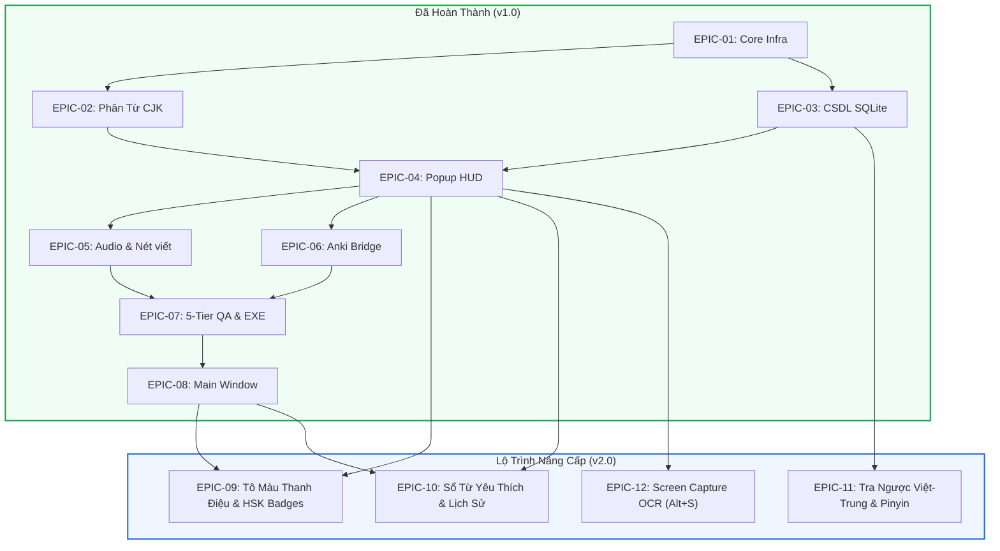

# MASTER ROADMAP: HANZII DICT DESKTOP

> **Dự án**: Hanzii Dict Desktop (Popup Dictionary for Anki & Windows)  
> **Kiến trúc tiêu chuẩn**: Spec-Driven Development, Modular Architecture, UI Design System, 5-Tier QA Lifecycle.  
> **Phiên bản hiện tại**: 2.0.0 (Roadmap Evolution)  
> **Cập nhật lần cuối**: 2026-10-15

---

## 1. TỔNG QUAN DỰ ÁN & MỤC TIÊU CỐT LÕI

Hanzii Dict Desktop là ứng dụng từ điển tiếng Trung thông minh chạy nền trên Windows, tối ưu đặc biệt cho việc học từ vựng trên Anki, duyệt tài liệu chữ Hán và tra cứu đa phương tiện tức thì.

- **Các trụ cột công nghệ đã hoàn thành (v1.0)**:
  1. Phân từ tiếng Trung thông minh (Jieba CJK Tokenization).
  2. Bắt từ siêu tốc qua phím tắt toàn cục không chặn (`Alt + Q`, `SendInput` batch, tương thích 100% với bộ gõ VCKey).
  3. CSDL 122.500+ từ vựng offline SQLite FTS5 (< 5ms phản hồi).
  4. HUD Lingoes độc lập, tự động neo theo con trỏ chuột và tự ẩn thông minh.
  5. Audio phát âm đa tầng (Google Native HD, Baidu Fanyi, Azure Neural, Windows Speech).
  6. Tích hợp câu ví dụ song ngữ Tatoeba HSK 1 - 6 (4.700+ từ vựng).
  7. Đồng bộ thẻ Anki 1-click qua AnkiConnect.

---

## 2. MA TRẬN PHÂN RÃ CÁC PHÂN HỆ (EPIC BREAKDOWN TABLE)

| Mã Epic | Tên Phân Hệ | Mức Độ Ưu Tiên | Thư Mục Spec | Trạng Thái |
| :--- | :--- | :--- | :--- | :--- |
| `EPIC-01` | **Khung Nền Tảng & Cổng Kiến Trúc** | P0 (Bắt buộc) | `docs/specs/features/01-core-infra/` | `COMPLETED` |
| `EPIC-02` | **Engine Phân Từ CJK Thông Minh** | P0 (Bắt buộc) | `docs/specs/features/02-segmentation/` | `COMPLETED` |
| `EPIC-03` | **CSDL Từ Điển Offline SQLite FTS5** | P0 (Bắt buộc) | `docs/specs/features/03-dictionary-engine/` | `COMPLETED` |
| `EPIC-04` | **Cửa Sổ Nổi Popup HUD & Phím Tắt Toàn Cục** | P0 (Bắt buộc) | `docs/specs/features/04-popup-hud/` | `COMPLETED` |
| `EPIC-05` | **Audio Phát Âm AI & Bút Thuận Nét Viết** | P1 (Quan trọng) | `docs/specs/features/05-audio-stroke/` | `COMPLETED` |
| `EPIC-06` | **Tích Hợp Anki Hai Chiều** | P1 (Quan trọng) | `docs/specs/features/06-anki-integration/` | `COMPLETED` |
| `EPIC-07` | **Cổng QA Kim Tự Tháp 5 Tầng & Đóng Gói .EXE** | P0 (Bắt buộc) | `docs/specs/features/07-qa-packaging/` | `COMPLETED` |
| `EPIC-08` | **Giao Diện Quản Trị & Cài Đặt Đa Cửa Sổ** | P0 (Bắt buộc) | `docs/specs/features/08-main-window/` | `COMPLETED` |
| `EPIC-09` | **Tô Màu Thanh Điệu Pinyin & Huy Hiệu HSK 1 - 6** | P1 (Quan trọng) | `docs/specs/features/09-tone-and-hsk/` | `COMPLETED` |
| `EPIC-10` | **Sổ Tay Từ Yêu Thích ⭐ & Lịch Sử Tra Cứu** | P1 (Quan trọng) | `docs/specs/features/10-favorites-history/` | `READY_FOR_DEV` |
| `EPIC-11` | **Tra Cứu Ngược Việt - Trung & Pinyin Không Dấu** | P1 (Quan trọng) | `docs/specs/features/11-reverse-search/` | `READY_FOR_DEV` |
| `EPIC-12` | **Chụp Màn Hình Nhận Diện Chữ Hán (Screen Capture OCR)** | P1 (Vũ khí cạnh tranh) | `docs/specs/features/12-screen-ocr/` | `READY_FOR_DEV` |

---

## 3. MA TRẬN PHỤ THUỘC (DEPENDENCY GRAPH)

---

## 4. LỘ TRÌNH THỰC THI CUỐN CHIẾU (PHASE-GATED ROADMAP)

### Phase 1: Thị Giác & Ghi Nhớ Ngôn Ngữ (`EPIC-09`)
- Triển khai **Tô màu thanh điệu Pinyin** theo chuẩn Pleco (Thanh 1 đỏ, Thanh 2 vàng, Thanh 3 xanh lá, Thanh 4 xanh dương).
- Gắn **Huy hiệu phân loại HSK 1 đến HSK 6** cạnh mỗi từ vựng.
- Kiểm thử tự động $\rightarrow$ Nghiệm thu $\rightarrow$ Đóng gói Phase 1.

### Phase 2: Cá Nhân Hóa Dữ Liệu Học Tập (`EPIC-10`)
- Nút Bookmark ⭐ trên HUD Titlebar & Main Window.
- Tab "Sổ từ & Lịch sử" trên Cửa sổ chính, hỗ trợ tìm kiếm và xóa lịch sử.
- Kiểm thử tự động $\rightarrow$ Nghiệm thu $\rightarrow$ Đóng gói Phase 2.

### Phase 3: Tra Cứu Đa Chiều (`EPIC-11`)
- Tra ngược từ nghĩa tiếng Việt $\rightarrow$ từ vựng tiếng Trung tương ứng.
- Tra cứu bằng Pinyin không dấu (vd: `nihao` $\rightarrow$ `你好`).
- Kiểm thử tự động $\rightarrow$ Nghiệm thu $\rightarrow$ Đóng gói Phase 3.

### Phase 4: Tính Năng Sát Thủ - Screen Capture OCR (`EPIC-12`)
- Phím tắt toàn cục `Alt + S` mở lớp phủ chụp màn hình.
- Nhận diện chữ Hán trên ảnh/video bằng Windows Native OCR Engine.
- Tự động bật HUD Lingoes tra cứu tức thì trong `< 200ms`.
- Đóng gói bản Release chính thức v2.0.0.
