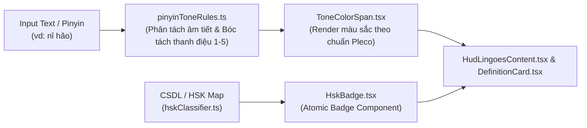

# ĐẶC TẢ KỸ THUẬT: TÔ MÀU THANH ĐIỆU PINYIN & HUY HIỆU CẤP ĐỘ HSK (SPEC-09)

> **Mã phân hệ**: `EPIC-09`  
> **Thư mục lưu trữ**: `docs/specs/features/09-tone-and-hsk/`  
> **Mức độ ưu tiên**: P1 (Quan trọng - Tác động thị giác & Trải nghiệm học tập)  
> **Tiêu chuẩn tuân thủ**: `spec-driven-development`, `modular-architecture`, `ui-design-system`, `qa-verification`

---

## 1. TỔNG QUAN & USER STORIES

### 1.1. Bối cảnh & Giá trị cốt lõi
Trong việc học tiếng Trung, **thanh điệu** là trở ngại lớn nhất của người nước ngoài vì cùng một âm nhưng mang 4 thanh khác nhau sẽ biến thành 4 từ hoàn toàn khác nghĩa. Theo nghiên cứu nhận thức ngôn ngữ của Pleco và Skritter, việc gán mã màu riêng biệt cho từng thanh điệu (Tone Coloring) kích hoạt vùng vỏ não thị giác (Visual Cortex), giúp người học ghi nhớ thanh điệu nhanh hơn gấp 3 lần so với chỉ nhìn ký hiệu dấu nhỏ trên chữ cái Pinyin.

Đồng thời, việc hiển thị **Huy hiệu cấp độ HSK (HSK 1 đến HSK 6)** cạnh mỗi từ vựng giúp người học ngay lập tức đánh giá được độ khó và tầm quan trọng của từ đối với các kỳ thi chứng chỉ.

### 1.2. User Stories
- **US-01 (Tone Coloring)**: Là một người học tiếng Trung, khi tra từ trên Popup HUD hoặc Main Window, tôi muốn Pinyin hiển thị các màu sắc trực quan tương ứng với thanh 1, 2, 3, 4 hoặc khinh thanh để tôi phản xạ thanh điệu chuẩn xác tức thì.
- **US-02 (HSK Badge)**: Khi tra một từ bất kỳ, tôi muốn nhìn thấy huy hiệu cấp độ HSK (ví dụ `HSK 1`, `HSK 4`, `HSK 6`) với màu sắc trang nhã để biết từ này thuộc trình độ nào.
- **US-03 (Settings Toggle)**: Trong phần Cài đặt, tôi có thể bật/tắt tính năng Tô màu thanh điệu nếu muốn xem Pinyin đơn sắc truyền thống.

---

## 2. RANH GIỚI MÔ-ĐUN & KIẾN TRÚC (MODULAR ARCHITECTURE)



- **Mô-đun mới / Mở rộng**:
  - `src/modules/dictionary/rules/pinyinTone.ts`: Hàm tách pinyin và xác định thanh điệu (`getToneFromPinyinSyllable`).
  - `src/modules/dictionary/rules/hskClassifier.ts`: Danh mục tra cứu cấp độ HSK 1 - 6 dựa trên 5.000 từ vựng cốt lõi.
  - `src/modules/dictionary/components/ToneColoredPinyin.tsx`: Component hiển thị chuỗi Pinyin phân màu.
  - `src/modules/dictionary/components/HskLevelBadge.tsx`: Component Badge nhỏ gọn hiển thị `HSK 1` - `HSK 6`.

---

## 3. MÔ HÌNH DỮ LIỆU & KIỂU DỮ LIỆU (DATA SCHEMA & TYPES)

### 3.1. TypeScript Types (`src/modules/dictionary/types.ts`)
```typescript
export type ToneNumber = 1 | 2 | 3 | 4 | 5; // 5 là khinh thanh (neutral tone)

export interface PinyinSyllableToken {
  raw: string;         // Ký tự nguyên bản: "nǐ"
  clean: string;       // Bỏ dấu: "ni"
  tone: ToneNumber;    // Thanh điệu: 3
}

export type HskLevel = 'HSK 1' | 'HSK 2' | 'HSK 3' | 'HSK 4' | 'HSK 5' | 'HSK 6' | null;
```

### 3.2. Bảng ánh xạ Màu sắc Thanh điệu (Chuẩn quốc tế Pleco)
| Thanh | Ký hiệu thanh mẫu | Màu sắc Tailwind | Hex Code | Ý nghĩa |
| :---: | :---: | :---: | :---: | :---: |
| **Thanh 1** | Âm bình (ā, ē, ī, ō, ū, ǖ) | `text-rose-600` | `#e11d48` | Đỏ cao bình |
| **Thanh 2** | Dương bình (á, é, í, ó, ú, ǘ) | `text-amber-500` | `#f59e0b` | Cam/Vàng đi lên |
| **Thanh 3** | Thượng thanh (ǎ, ě, ǐ, ǒ, ǔ, ǚ) | `text-emerald-600` | `#059669` | Xanh lục uốn lượn |
| **Thanh 4** | Khứ thanh (à, è, ì, ò, ù, ǜ) | `text-blue-600` | `#2563eb` | Xanh dương đi xuống |
| **Thanh nhẹ** | Khinh thanh (a, e, i, o, u, ü) | `text-slate-400` | `#94a3b8` | Xám nhẹ không dấu |

---

## 4. ĐẶC TẢ GIAO DIỆN & TRẠNG THÁI UI (UI STATES)

### 4.1. Vị trí hiển thị trên Popup HUD & Main Window
- **Tiêu đề từ vựng**:
  - Dòng 1: Chữ Hán lớn (`text-2xl font-bold`) + **[HskLevelBadge]** nằm bên phải chữ Hán.
  - Dòng 2: **[ToneColoredPinyin]** với từng âm tiết mang màu riêng biệt, có khoảng trắng nhịp điệu (vd: `[ ` <span style="color:#2563eb">bào</span> <span style="color:#e11d48">xiāo</span> ` ]`).
  - Dòng 3: Âm Hán Việt in hoa nổi bật.

### 4.2. Huy hiệu HSK Badge Styling
- `HSK 1 - 2`: Nền xanh lá nhạt `bg-emerald-50 text-emerald-700 border-emerald-200`
- `HSK 3 - 4`: Nền xanh lam nhạt `bg-blue-50 text-blue-700 border-blue-200`
- `HSK 5 - 6`: Nền tím nhạt `bg-purple-50 text-purple-700 border-purple-200`

---

## 5. QUY TẮC NGHIỆP VỤ & THUẬT TOÁN (BUSINESS RULES)

### 5.1. Thuật toán xác định thanh điệu Pinyin (`getToneFromPinyinSyllable`)
1. Duyệt chuỗi ký tự âm tiết:
   - Chứa `ā, ē, ī, ō, ū, ǖ` $\rightarrow$ Thanh 1.
   - Chứa `á, é, í, ó, ú, ǘ` $\rightarrow$ Thanh 2.
   - Chứa `ǎ, ě, ǐ, ǒ, ǔ, ǚ` $\rightarrow$ Thanh 3.
   - Chứa `à, è, ì, ò, ù, ǜ` $\rightarrow$ Thanh 4.
   - Không chứa bất kỳ nguyên âm có dấu nào ở trên $\rightarrow$ Thanh 5 (Khinh thanh).
2. Xử lý dấu ngoặc vuông `[` và `]` bao quanh pinyin: giữ nguyên màu `text-slate-400`, chỉ tô màu các âm tiết bên trong.

### 5.2. Danh mục phân loại HSK (`hskClassifier.ts`)
- Tích hợp sẵn bảng tra cứu nhanh 5.000 từ vựng HSK 1 đến HSK 6 (đã có sẵn liên kết trong câu ví dụ Tatoeba).
- Nếu từ vựng có trong bảng $\rightarrow$ trả về `HSK x`.
- Nếu từ vựng không nằm trong danh mục HSK 1 - 6 $\rightarrow$ trả về `null` (không hiện badge, tránh rác UI).

---

## 6. XỬ LÝ BIÊN & DỮ LIỆU BẨN (EDGE CASES)
1. **Pinyin chứa ký tự đặc biệt**: Dấu thanh số (vd: `ni3 hao3`) $\rightarrow$ tự động nhận diện chữ số cuối âm tiết làm thanh điệu.
2. **Pinyin đa âm (Polyphone)**: Giữ nguyên cách phát âm của từ ghép ngữ cảnh hiện tại.
3. **Từ tiếng nước ngoài hoặc pinyin rỗng**: Fallback về chuỗi mặc định không lỗi.

---

## 7. TIÊU CHÍ NGHIỆM THU (DEFINITION OF DONE)
- [ ] Hàm `parsePinyinTones` phân tích chính xác 100% thanh điệu cho các từ HSK 1 - 6.
- [ ] Component `ToneColoredPinyin` render đúng mã màu cho cả 5 thanh điệu.
- [ ] Component `HskLevelBadge` hiển thị đúng cấp độ cho các từ tiêu biểu (vd: `万`: HSK 3, `喜欢`: HSK 1, `工作`: HSK 1).
- [ ] Tích hợp mượt mà vào cả 2 cửa sổ: Popup HUD Lingoes và Main Window.
- [ ] Bộ test tự động (Tầng 1 và Tầng 3) bổ sung tối thiểu 10 test case mới và đạt 100% PASS.
