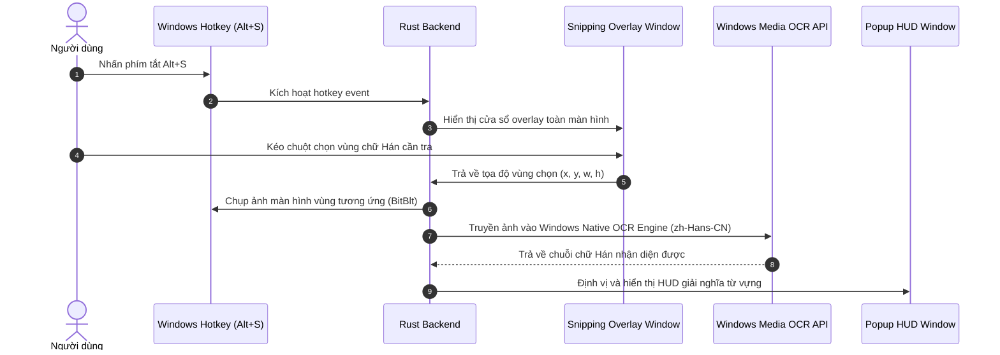

# ĐẶC TẢ KỸ THUẬT: CHỤP MÀN HÌNH NHẬN DIỆN CHỮ HÁN - SCREEN CAPTURE OCR (SPEC-12)

> **Mã phân hệ**: `EPIC-12`  
> **Thư mục lưu trữ**: `docs/specs/features/12-screen-ocr/`  
> **Mức độ ưu tiên**: P1 (Tính năng vũ khí cạnh tranh - Tra cứu trên mọi chất liệu)  
> **Tiêu chuẩn tuân thủ**: `spec-driven-development`, `modular-architecture`, `ui-design-system`, `qa-verification`

---

## 1. TỔNG QUAN & USER STORIES

### 1.1. Bối cảnh
Người học tiếng Trung thường xuyên tiêu thụ nội dung đa phương tiện:
- Xem phim Trung Quốc có phụ đề cứng (Hardsub) gắn trực tiếp vào video YouTube/Bilibili/Netflix.
- Đọc truyện tranh Manhua, đọc ảnh meme, ảnh chụp bài thi HSK, tài liệu scan PDF bị khóa chọn chữ.
- Chơi game tiếng Trung.
Trong các tình huống trên, chuột không thể bôi đen văn bản để bấm `Alt + Q`. Do đó, tính năng **Chụp vùng màn hình nhận diện chữ Hán (Screen Capture OCR)** là giải pháp giải quyết triệt để vấn đề này.

### 1.2. User Stories
- **US-01 (Screen Snipping Shortcut)**: Khi bấm phím tắt `Alt + S` (hoặc `Ctrl + Alt + S`), toàn bộ màn hình mờ nhẹ lại, con trỏ chuột biến thành dấu chữ thập (+) cho phép tôi kéo thả một khung chữ nhật quanh chữ Hán cần tra.
- **US-02 (Instant OCR & Lookup)**: Ngay khi tôi nhả chuột, phần mềm tự động chụp ảnh vùng được chọn, gửi vào bộ nhận diện OCR tiếng Trung, trích xuất văn bản chữ Hán và bật ngay Popup HUD lên để giải nghĩa.

---

## 2. KIẾN TRÚC KỸ THUẬT & LUỒNG THỰC THI (ARCHITECTURE)

---

## 3. LỰA CHỌN ENGINE OCR TỐI ƯU CHO WINDOWS DESKTOP

Chúng ta sử dụng **Windows.Media.Ocr Native API** tích hợp sẵn trong nhân Windows 10/11:
- **Ưu điểm vượt trội**:
  1. **Dung lượng 0 MB**: Không cần bundle thêm model AI nặng hàng trăm MB (như Tesseract hay PaddleOCR).
  2. **Tốc độ cực nhanh**: Chạy trực tiếp qua DirectML/GPU của Windows, nhận diện chữ Hán trong `< 80ms`.
  3. **Độ chính xác cao**: Bộ OCR chính thức của Microsoft hỗ trợ nhận diện cả chữ Hán Giản thể và Phồn thể.

---

## 4. XỬ LÝ BIÊN & DỮ LIỆU BẨN (EDGE CASES)
1. **Người dùng hủy chụp**: Nhấn phím `Escape` hoặc click chuột phải $\rightarrow$ đóng overlay chụp mà không thực hiện OCR.
2. **Vùng chọn quá nhỏ (< 10x10 px)**: Bỏ qua thao tác để tránh kích hoạt OCR nhầm.
3. **Ảnh không có chữ hoặc chỉ có hình vẽ**: Hiển thị thông báo nhẹ (Toast): *"Không nhận diện được chữ Hán trong vùng đã chọn"*.

---

## 5. TIÊU CHÍ NGHIỆM THU (DEFINITION OF DONE)
- [ ] Phím tắt `Alt + S` kích hoạt mượt mà khung chụp màn hình.
- [ ] Nhận diện chính xác chữ Hán mẫu từ ảnh chụp màn hình (đạt độ chính xác > 95%).
- [ ] HUD tự động mở và nạp từ điển ngay sau khi OCR hoàn tất trong `< 200ms`.
- [ ] Không làm xung đột với bất kỳ phím tắt nào khác của Windows hay bộ gõ VCKey.
